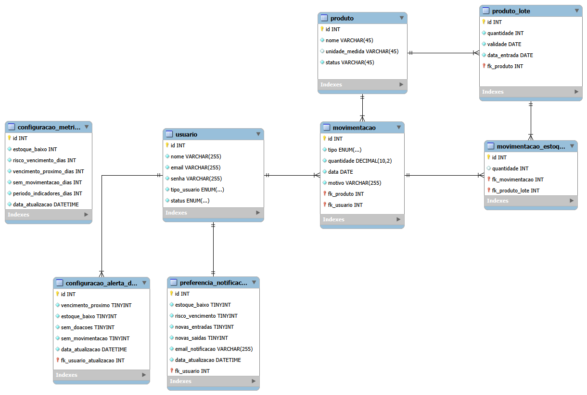
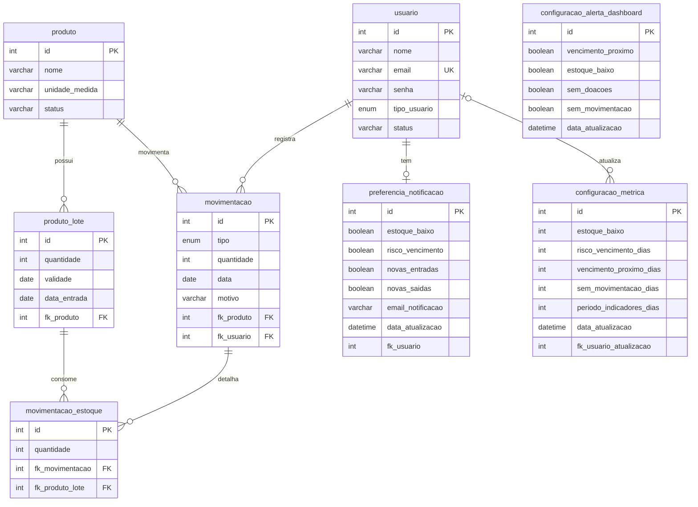

<div align="center">

# Banco de Dados — Sistema de Estoque da ONG AMAR

**Modelagem e script do banco `projeto_amar`, que guarda produtos, lotes, movimentações, usuários e as configurações do sistema de estoque de doações.**


</div>

---

## Sumário

- [Sobre o banco](#sobre-o-banco)
- [Visão geral das tabelas](#visão-geral-das-tabelas)
- [Diagrama](#diagrama)
- [Relacionamentos](#relacionamentos)
- [Dicionário de dados](#dicionário-de-dados)
- [Regras e decisões do modelo](#regras-e-decisões-do-modelo)
- [Como criar o banco](#como-criar-o-banco)
- [Arquivos desta pasta](#arquivos-desta-pasta)
- [Pontos em aberto](#pontos-em-aberto)
- [Roadmap](#roadmap)

---

## Sobre o banco

O banco `projeto_amar` dá suporte ao sistema de gerenciamento de estoque de uma ONG que trabalha com doações. Ele precisa responder, a qualquer momento:

- **O que entrou e o que saiu**, e quem registrou cada movimentação.
- **De qual lote** saiu cada item, para controlar a **validade**.
- **Quem pode acessar** o sistema e com qual perfil (administrador ou voluntário).
- **Quais limites e alertas** a ONG definiu para o dashboard e quais avisos cada usuário quer receber.

O SGBD é o **MySQL**. O ideal é a versão **8.0.16 ou superior**.

---

## Visão geral das tabelas

O banco tem **8 tabelas**, em três grupos:

| Grupo | Tabelas | Função |
| --- | --- | --- |
| **Estoque** | `produto`, `produto_lote`, `movimentacao`, `movimentacao_estoque` | Cadastro dos produtos, lotes com validade e histórico de entradas, saídas e perdas. |
| **Usuários** | `usuario` | Quem acessa o sistema, com e-mail, senha (hash) e perfil. |
| **Configurações** | `configuracao_metrica`, `configuracao_alerta_dashboard`, `preferencia_notificacao` | Limites do dashboard, alertas ativos e preferências de notificação por e-mail. |

---

## Diagrama



Versão em texto do mesmo modelo, que o GitHub desenha automaticamente:



---

## Relacionamentos

| Relação | Cardinalidade | Como ler |
| --- | --- | --- |
| `produto` e `produto_lote` | 1:N | Um produto tem vários lotes, e cada lote pertence a um produto. |
| `produto` e `movimentacao` | 1:N | Um produto tem várias movimentações. |
| `usuario` e `movimentacao` | 1:N | Um usuário registra várias movimentações. |
| `movimentacao` e `movimentacao_estoque` | 1:N | Uma movimentação pode afetar vários lotes. |
| `produto_lote` e `movimentacao_estoque` | 1:N | Um lote pode aparecer em várias movimentações. |
| `movimentacao` e `produto_lote` | N:N | Resolvida pela tabela associativa `movimentacao_estoque`. |
| `usuario` e `preferencia_notificacao` | 1:1 | Cada usuário tem uma única linha de preferências. |
| `usuario` e `configuracao_metrica` | 1:N (opcional) | Indica quem fez a última alteração das métricas. |

`configuracao_metrica` e `configuracao_alerta_dashboard` são **globais da ONG** e têm uma única linha (`id = 1`).

---

## Dicionário de dados

### `produto`

Itens que a ONG recebe e distribui.

| Coluna | Tipo | Restrições | Descrição |
| --- | --- | --- | --- |
| `id` | INT | PK, auto incremento | Identificador do produto. |
| `nome` | VARCHAR(45) | NOT NULL | Nome do produto. |
| `unidade_medida` | VARCHAR(45) | opcional | Unidade usada no estoque (kg, litro, unidade...). |
| `status` | VARCHAR(45) | NOT NULL, padrão `ATIVO` | Situação do cadastro. |

### `produto_lote`

Cada entrada de um produto, com sua validade.

| Coluna | Tipo | Restrições | Descrição |
| --- | --- | --- | --- |
| `id` | INT | PK, auto incremento | Identificador do lote. |
| `quantidade` | INT | NOT NULL | Quantidade do lote. |
| `validade` | DATE | opcional | Data de validade. Fica vazia para itens que não vencem. |
| `data_entrada` | DATE | NOT NULL | Data em que o lote entrou no estoque. |
| `fk_produto` | INT | FK, NOT NULL | Produto ao qual o lote pertence. |

### `usuario`

Pessoas que acessam o sistema.

| Coluna | Tipo | Restrições | Descrição |
| --- | --- | --- | --- |
| `id` | INT | PK, auto incremento | Identificador do usuário. |
| `nome` | VARCHAR(255) | NOT NULL | Nome completo. |
| `email` | VARCHAR(255) | NOT NULL, único | E-mail usado no login. |
| `senha` | VARCHAR(255) | NOT NULL | Senha **com hash**, nunca em texto puro. |
| `tipo_usuario` | ENUM | NOT NULL | `ADMINISTRADOR` ou `VOLUNTARIO`. |
| `status` | VARCHAR(45) | NOT NULL | Situação do usuário (ativo ou inativo). |

### `movimentacao`

Registro de cada entrada, saída ou perda de um produto.

| Coluna | Tipo | Restrições | Descrição |
| --- | --- | --- | --- |
| `id` | INT | PK, auto incremento | Identificador da movimentação. |
| `tipo` | ENUM | NOT NULL | `ENTRADA`, `SAIDA` ou `PERDA`. |
| `quantidade` | INT | NOT NULL | Quantidade movimentada. |
| `data` | DATE | NOT NULL | Data da movimentação. |
| `motivo` | VARCHAR(255) | NOT NULL | Motivo informado pelo usuário. |
| `fk_produto` | INT | FK, NOT NULL | Produto movimentado. |
| `fk_usuario` | INT | FK, NOT NULL | Usuário que registrou. |

### `movimentacao_estoque`

Tabela associativa que liga uma movimentação aos lotes afetados.

| Coluna | Tipo | Restrições | Descrição |
| --- | --- | --- | --- |
| `id` | INT | PK, auto incremento | Identificador. |
| `quantidade` | INT | NOT NULL | Quanto foi retirado ou colocado naquele lote. |
| `fk_movimentacao` | INT | FK, NOT NULL | Movimentação de origem. |
| `fk_produto_lote` | INT | FK, NOT NULL | Lote afetado. |

### `configuracao_metrica`

Limites usados nos cartões e alertas do dashboard. Linha única (`id = 1`).

| Coluna | Tipo | Restrições | Descrição |
| --- | --- | --- | --- |
| `id` | INT | PK, NOT NULL | Sempre `1`. |
| `estoque_baixo` | INT | NOT NULL | Quantidade abaixo da qual o produto está com estoque baixo. |
| `risco_vencimento_dias` | INT | NOT NULL | Prazo, em dias, para um item entrar em risco de vencimento. |
| `vencimento_proximo_dias` | INT | NOT NULL | Prazo, em dias, para o alerta de vencimento próximo. |
| `sem_movimentacao_dias` | INT | NOT NULL | Dias sem movimentação para o produto ser considerado parado. |
| `periodo_indicadores_dias` | INT | NOT NULL | Janela, em dias, usada no cálculo dos indicadores. |
| `data_atualizacao` | DATETIME | NOT NULL, automática | Atualizada a cada alteração da linha. |
| `fk_usuario_atualizacao` | INT | opcional | Usuário que fez a última alteração. |

### `configuracao_alerta_dashboard`

Define quais alertas aparecem no dashboard. Linha única (`id = 1`).

| Coluna | Tipo | Restrições | Descrição |
| --- | --- | --- | --- |
| `id` | INT | PK, NOT NULL | Sempre `1`. |
| `vencimento_proximo` | BOOLEAN | NOT NULL | Alerta de produtos perto de vencer. |
| `estoque_baixo` | BOOLEAN | NOT NULL | Alerta de estoque baixo. |
| `sem_doacoes` | BOOLEAN | NOT NULL | Alerta de período sem doações. |
| `sem_movimentacao` | BOOLEAN | NOT NULL | Alerta de produtos parados. |
| `data_atualizacao` | DATETIME | NOT NULL, automática | Atualizada a cada alteração da linha. |

### `preferencia_notificacao`

O que cada usuário quer receber por e-mail.

| Coluna | Tipo | Restrições | Descrição |
| --- | --- | --- | --- |
| `id` | INT | PK, auto incremento | Identificador. |
| `estoque_baixo` | BOOLEAN | NOT NULL, padrão ligado | Avisar sobre estoque baixo. |
| `risco_vencimento` | BOOLEAN | NOT NULL, padrão ligado | Avisar sobre risco de vencimento. |
| `novas_entradas` | BOOLEAN | NOT NULL, padrão ligado | Avisar sobre novas entradas. |
| `novas_saidas` | BOOLEAN | NOT NULL, padrão ligado | Avisar sobre novas saídas. |
| `email_notificacao` | VARCHAR(255) | opcional | E-mail que recebe os avisos. |
| `data_atualizacao` | DATETIME | NOT NULL, automática | Atualizada a cada alteração da linha. |
| `fk_usuario` | INT | NOT NULL | Usuário dono das preferências. |

---

## Regras e decisões do modelo

- **Estoque por lote:** o estoque de um produto é a soma dos seus lotes. Cada entrada cria um lote com validade, e cada saída ou perda informa, em `movimentacao_estoque`, de quais lotes a quantidade saiu.
- **Tipos de movimentação:** `ENTRADA`, `SAIDA` e `PERDA`. A perda registra itens descartados, por exemplo por vencimento, sem contar como saída para distribuição.
- **Validade opcional:** `produto_lote.validade` aceita nulo, para itens que não vencem.
- **Sem categoria:** o modelo não tem tabela de categoria. O produto é descrito por nome, unidade de medida e status.
- **Senhas com hash:** `usuario.senha` tem 255 caracteres para caber o hash (BCrypt, por exemplo). A senha nunca é guardada em texto puro.
- **Configurações globais:** métricas e alertas são da ONG inteira, com uma única linha (`id = 1`). Já as preferências de notificação são individuais, com uma linha por usuário.
- **Validação no backend:** as regras das tabelas de configuração, como valores mínimos das métricas, linha única e uma linha de preferências por usuário, são garantidas pelo backend. Por isso essas tabelas não têm `CHECK`, `UNIQUE` nem chaves estrangeiras, e `fk_usuario` e `fk_usuario_atualizacao` são colunas comuns, com relação apenas lógica.
- **Valores padrão fora do banco:** os valores iniciais de métricas e alertas ficam no frontend. O banco não insere linhas iniciais. A primeira gravação cria a linha `id = 1`, e as seguintes atualizam, com `INSERT ... ON DUPLICATE KEY UPDATE`.
- **Auditoria simples:** as tabelas de configuração guardam `data_atualizacao`, atualizada automaticamente pelo banco a cada alteração.

---

## Como criar o banco

O script usa `CREATE TABLE IF NOT EXISTS`, então pode ser executado de novo sem apagar dados. Em contrapartida, ele **não altera** tabelas que já existem.

**Pelo terminal:**

```bash
mysql -u <usuario> -p < modelagem/projeto_amar.sql
```

**Pelo MySQL Workbench:** abra o arquivo `projeto_amar.sql` em *File > Open SQL Script* e execute com o botão do raio.

**Para conferir:**

```sql
USE projeto_amar;
SHOW TABLES;
```

O resultado deve listar as 8 tabelas.

**Para recriar do zero (apaga todos os dados):**

```sql
DROP DATABASE IF EXISTS projeto_amar;
```

Depois, execute o script novamente.

---

## Arquivos desta pasta

```text
modelagem/
├── modelagem_pca_v2.png   # Diagrama do banco (MySQL Workbench)
└── projeto_amar.sql       # Script de criação do banco e das tabelas
```

---

## Pontos em aberto

- **Tipo da quantidade:** `quantidade` é `INT` em `produto_lote`, `movimentacao` e `movimentacao_estoque`. Se o estoque tiver itens medidos em kg ou litros, trocar para `DECIMAL(10,2)` nas três tabelas, para que a soma dos lotes bata com a movimentação.
- **Status do usuário:** `usuario.status` é `VARCHAR(45)`. Se virar `ENUM`, os valores precisam ser os mesmos que o backend envia (por exemplo, `Ativo` e `Inativo`).
- **Chaves das configurações:** as relações das tabelas de configuração com `usuario` são lógicas. Se a equipe quiser que o banco garanta a integridade, basta adicionar as chaves estrangeiras e o `UNIQUE` em `preferencia_notificacao.fk_usuario`.

---

## Roadmap

- [ ] Definir o tipo final de `quantidade` (`INT` ou `DECIMAL`)
- [ ] Definir se `usuario.status` vira `ENUM`
- [ ] Criar os endpoints que gravam métricas, alertas e preferências nas novas tabelas
- [ ] Criar índices para as consultas mais usadas (movimentações por data e lotes por validade)
- [ ] Versionar as alterações do banco com migrações (Flyway ou Liquibase)

---

<div align="center">

Feito com dedicação para apoiar o trabalho da **ONG AMAR** 💙

</div>